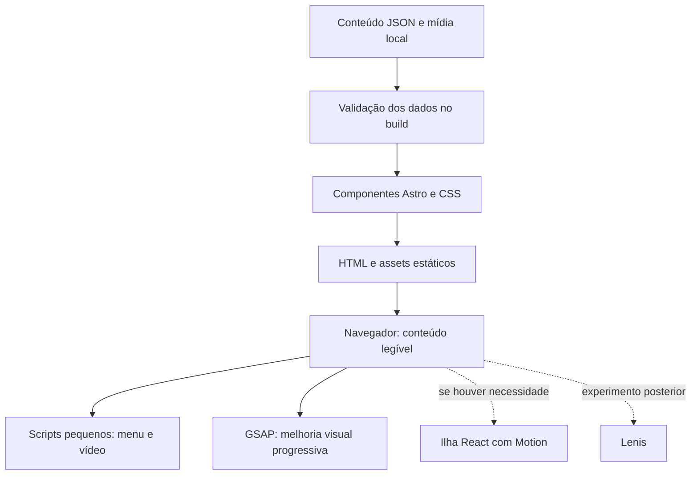

# Arquitetura — BASE Vôlei Club

## Implementação inicial (01/11/2026)

O scaffold está em uso: Astro com geração estática, TypeScript, CSS, conteúdo local, layout compartilhado, página editorial, aviso ilustrativo e escudo de referência em `public/brand`. Dependências e versões exatas estão registradas em `package.json` e `package-lock.json`. `npm run check` e `npm run build` passaram. Ainda não há vídeo, canal oficial, mídia real, animações ou validação visual em aparelhos.

## Proposta e escopo

### Movimento implementado — 01/11/2026 (evoluído em 03/11/2026 — SPEC-007)

Em 03/11/2026 ([SPEC-007](docs/specs/007-background-tatico-e-stack-animacao.md)), a stack completa planejada (**GSAP + ScrollTrigger**, **Lenis** e **React + Motion**) foi integrada:
- A hero usa CSS para a aproximação inicial da foto e a entrada do título, com redução de movimento via media query. Nas demais seções, ambient.ts insere camadas decorativas e ambient.css anima quadra, trajetórias, luzes e faixas visíveis.
- `src/scripts/motion.ts` coordena o preenchimento progressivo da linha do tempo (`[data-timeline-progress]`) via `ScrollTrigger` `scrub`, entradas escalonadas (`stagger`) das seções e a sincronização do `Lenis` alimentado exclusivamente pelo `gsap.ticker`.
- `src/components/TeamsShowcase.tsx` (hidratado com `client:visible` em `TeamsSection.astro`) usa `motion/react` (`AnimatePresence`, `motion.div`, `motion.article`, `layoutId`) para filtragem interativa por equipe e destaque tático de zona/posição em quadra, preservando SSR sem JS e respeitando `propertyOwnershipRule`.


A direção esportiva escolhida na comparação foi implementada em `src/scripts/motion.ts`, importado pelo script processado do layout Astro. Web Animations API coordena a abertura e IntersectionObserver dispara revelações únicas nas seções. O HTML permanece visível por padrão, a preferência de redução de movimento cancela animações ativas e o foco do teclado libera imediatamente elementos em revelação. Não houve adição de dependências: os efeitos aprovados foram atendidos pelos recursos nativos já usados na simulação. GSAP/ScrollTrigger permanecem alternativas para uma necessidade futura que justifique sua adoção. Ver [SPEC-005](docs/specs/005-movimento-esportivo.md).

Base recomendada: **Astro + TypeScript + CSS + GSAP/ScrollTrigger**, com geração estática. **React/Motion e Lenis são opcionais**. A primeira versão é um site público editorial; não há necessidade demonstrada de login, banco de dados, API própria, painel administrativo ou sistema de inscrições.

Conteúdo local versionado no Git permite apresentar o projeto antes de coletar a história real. Uma alteração de conteúdo exige novo build/publicação. Isso é adequado ao início, mas não entrega atualização em tempo real de placares ou Instagram.

As bibliotecas abaixo são explicadas por função. Sua combinação não é uma lista de dependências obrigatórias. Escolher versões compatíveis ao criar o repositório e registrar o lockfile; este kit não fixa versões nem comprova um build executado.

## Como o Astro funciona

Um componente `.astro` reúne preparação de dados, template HTML e estilos. Na saída estática, o código de preparação executa durante o build; o visitante recebe HTML, CSS e somente os scripts necessários. Conteúdo institucional não precisa se tornar uma aplicação React inteira.

Astro também renderiza componentes de frameworks. Um componente React pode ser renderizado como HTML sem interatividade; para executá-lo no navegador é preciso uma diretiva de cliente. `client:load` hidrata ao carregar; `client:visible` adia a hidratação até a visibilidade. Hidratar é conectar o comportamento JavaScript à interface já renderizada. Isso se aplica a componentes de framework, não significa que todo componente `.astro` usa `client:*`.

Referência: [arquitetura de ilhas do Astro](https://docs.astro.build/en/concepts/islands/).

Para o BASE, história, staff, apoiadores, listas de resultados e agenda são HTML. Um pequeno script pode controlar menu e vídeo. CSS com overflow horizontal atende à faixa de atletas. React só entra se houver uma interação que justifique seu custo.

## Responsabilidade de cada tecnologia

| Tecnologia | O que faz | Uso proposto |
| --- | --- | --- |
| Astro | Monta páginas e componentes; pode gerar HTML estático e ilhas interativas. | Base da página e renderização do conteúdo. |
| TypeScript | Descreve tipos e ajuda a detectar inconsistências no desenvolvimento. | Contratos de conteúdo e scripts; não substitui validação de dados externos. |
| CSS | Layout, cores, responsividade e transições simples. | Grid/Flex, foco, hover e faixas horizontais. |
| GSAP | Controla interpolação e sequências de animação. | Revelações pontuais. |
| ScrollTrigger | Relaciona animação à posição da rolagem; suporta gatilhos, scrub e pin. | Entradas de seções; evitar pin no mobile. |
| React | Componentes com estado e atualização de interface. | Alternativa futura para interações específicas. |
| Motion para React | Anima componentes React, gestos, entrada/saída e layout. | Somente em uma ilha React que precise desses recursos. |
| Lenis | Suaviza a rolagem e pode sincronizá-la com outros efeitos. | Experimento opcional depois de validar a versão com scroll nativo. |

Referências: [ScrollTrigger](https://gsap.com/docs/v3/Plugins/ScrollTrigger/), [Motion para React](https://motion.dev/docs/react), [Lenis](https://github.com/darkroomengineering/lenis).

## Fluxo de renderização proposto



Não introduzir dependência entre a leitura da história e o carregamento do vídeo ou das animações.

## GSAP e ScrollTrigger na prática

GSAP pode animar propriedades do DOM independentemente do Astro ou do React. Uma timeline organiza entradas em sequência. ScrollTrigger observa os pontos de início/fim e dispara ou vincula a animação ao scroll. `scrub` associa progresso a rolagem; `pin` mantém um elemento fixado por um trecho. Esses recursos existem, mas o BASE não precisa usá-los em todas as seções.

Implementação proposta: importar GSAP em um módulo de melhoria progressiva, registrar ScrollTrigger e selecionar elementos com atributos como `data-reveal`. Aplicar opacidade/deslocamento curtos só depois de inicializar o módulo; o HTML não pode nascer invisível por CSS esperando um script que pode falhar. Recalcular posições quando imagens/fontes alterarem medidas. Limpar listeners e animações ao desmontar componentes ou reexecutar inicialização.

Não adicionar navegação SPA/ClientRouter na primeira versão. Se isso mudar, definir explicitamente inicialização e limpeza entre navegações para evitar duplicação de animações.

## Motion para React: quando adicionar

É a biblioteca anteriormente conhecida como Framer Motion. O pacote atual documentado é `motion`, com importação de recursos React por `motion/react`. Oferece animações declarativas e recursos ligados a estado, gestos, layout e entrada/saída. [Documentação oficial](https://motion.dev/docs/react).

Exemplo conceitual de evolução: um seletor de equipe que troca a lista de atletas e anima essa transição. Se a filtragem simples com JavaScript e CSS já atender, manter a solução menor. Se uma ilha React for escolhida, integrar React ao Astro e decidir sua diretiva de hidratação. Conteúdo inicial deve continuar presente no HTML; não usar `client:only` apenas por conveniência.

GSAP e Motion podem coexistir, mas não devem controlar simultaneamente as mesmas propriedades no mesmo elemento. Divisão possível: GSAP na narrativa da página; Motion dentro da ilha React. Não adicionar os dois motores para a mesma revelação visual.

## Lenis: avaliação opcional

Lenis altera a sensação da rolagem; ele não cria por si a narrativa, o parallax ou a animação de texto. A documentação mostra integração com ScrollTrigger atualizando-o em eventos de scroll e chamando `lenis.raf()` pelo ticker do GSAP. [Integração oficial](https://github.com/darkroomengineering/lenis#gsap-scrolltrigger).

Se adotado, usar **um único mecanismo para alimentar o RAF**: modo automático ou ticker integrado, nunca os dois juntos. O ticker do GSAP usa segundos e `lenis.raf` recebe milissegundos. Guardar a função registrada para removê-la na limpeza e destruir a instância Lenis. Qualquer ajuste global do ticker precisa ser avaliado e documentado.

Nesta arquitetura, manter scroll nativo inicialmente. Só experimentar Lenis após medir ganho visual em aparelhos reais. Validar ancoragem, teclado, diálogo de vídeo, carrosséis e áreas de scroll aninhadas. O README consultado registra limitações com CSS scroll-snap; não presumir compatibilidade entre Lenis e as faixas nativas do projeto sem testar/configurar essa combinação. Com redução de movimento, manter experiência nativa e poster estático independentemente dos defaults da versão instalada.

## Estrutura sugerida para o futuro repositório

```text
docs/
  DESIGN.md
  ARCHITECTURE.md
  CONTENT.md
  HANDOFF.md
  references/mockup-latest.png
src/
  assets/                    # fotos e poster processáveis
  components/
    Header.astro
    HeroVideo.astro
    ProjectIntro.astro
    HistoryTimeline.astro
    StaffSection.astro
    CompetitionHistory.astro
    MatchResults.astro
    TeamsSection.astro
    ParticipationSection.astro
    EventAgenda.astro
    InstagramUpdates.astro
    PartnersSection.astro
    Footer.astro
  data/site.json             # adaptar content.sample.json
  types/content.ts
  layouts/BaseLayout.astro
  pages/index.astro
  scripts/motion.ts
  scripts/video.ts
  styles/tokens.css
  styles/global.css
public/
  brand/                    # SVG definitivo quando disponível
  video/                    # mídia otimizada; nenhuma está incluída
```

Não criar classes, repositórios de domínio ou serviços por entidade para uma página editorial. Os tipos de conteúdo e suas regras são suficientes neste estágio.

## Conteúdo e linguagem do domínio

Entidades editoriais: Projeto, Marco histórico, Profissional, Equipe, Atleta, Competição, Conquista, Partida, Evento, Informativo e Apoiador. Treinador, coordenação e comissão técnica são funções de profissionais; não são necessariamente pessoas diferentes.

- Toda unidade tem ID estável e status editorial: `draft`, `illustrative` ou `confirmed`.
- Partida agendada tem data e adversário quando conhecidos, sem resultado; partida concluída exige resultado confirmado para publicar placar.
- Evento distingue jogo e peneira. Datas reais devem ter fuso explícito. A agenda ordena eventos futuros e trata cancelamentos/adiamentos.
- Atleta vincula-se a equipe por ID. Só publicar informações apropriadas e autorizadas; não incluir telefone, escola, endereço, data completa de nascimento ou dados de responsáveis em perfil público.
- Não gerar anos de história, depoimentos atribuídos, títulos, número de atendidos ou credenciais para preencher layout.
- URL ausente permanece `null`; a interface apresenta orientação, não botão quebrado ou `href="#"` fingindo ação.

Para apresentação, `contentMode: illustrative` deve produzir indicação visível. Uma publicação oficial exige revisão editorial; isso pode ser um bloqueio no processo de release, sem impor ao protótipo a exigência de conteúdo já coletado.

## Instagram, participação e contato

Primeira versão: curadoria manual de informativos em JSON com título, imagem, resumo e permalink confirmado. Alterações entram via Git/build. Não raspar Instagram, prometer feed em tempo real ou embarcar tokens no frontend. API ou CMS só será avaliado se atualização manual se tornar um problema concreto. Embed de terceiros não é dependência inicial; carregar um embed posteriormente exigirá avaliar peso e comportamento.

Participação: inicialmente orientações e acesso ao canal oficial, quando definido. Não coletar inscrições ou dados de menores no protótipo. Um formulário futuro é uma nova spec: campos mínimos, responsável quando aplicável, armazenamento, acesso e fluxo de atendimento definidos antes da implementação.

Contato de apoio: link secundário para canal confirmado, sem planos de patrocínio ou valores inventados. Hosting, domínio, serviço de vídeo e canal de contato continuam pendentes; este kit não provisiona serviços.

## Mídia e desempenho

Poster responsivo com dimensões reservadas; priorizar a imagem visível da hero, sem lazy loading nela. Fotos abaixo da dobra carregam de forma adiada. Exportar tamanhos compatíveis com os slots e formatos modernos com fallback conforme suporte validado. Vídeo completo somente por ação do usuário; fundo decorativo deve ter poster, pausa e tratamento de rejeição de autoplay. Não baixar vídeo pesado para exibir um botão de play.

Metas propostas para validação em produção: LCP ≤ 2,5 s, INP ≤ 200 ms e CLS ≤ 0,1 no percentil 75 quando houver dados de campo. São metas, não resultados obtidos ou garantias. Inicialmente usar medidas de laboratório com perfil mobile e aparelho real; revisar a composição caso o vídeo prejudique a abertura.

## Verificação e comandos futuros

Após configurar o projeto, disponibilizar scripts equivalentes a `dev`, `check`, `build` e `preview`. Comandos esperados: `npm run dev`, `npm run check`, `npm run build`, `npm run preview`; eles ainda não existem neste pacote. O script `check` deve executar a checagem Astro/TypeScript configurada. Escolher uma versão Node suportada pela versão Astro selecionada, sem presumir um requisito não validado.

Verificar manualmente menu, player, pausa do fundo, teclado, foco, âncoras, estados sem dados, redução de movimento e ausência de JS. Automatizar regras reais de ordenação de agenda, validação de resultados e relações por ID quando forem implementadas. Testes de fluxo podem usar Playwright; não instalar uma estrutura grande de testes só para textos estáticos. Validar build e o HTML servido por preview antes de alegar conclusão.

## Evolução e trade-offs

Se a equipe precisar editar sem Git, avaliar CMS com build acionado por atualização. Se resultados exigirem atualização imediata, avaliar uma fonte dinâmica específica. Se surgirem inscrições, especificar o fluxo de dados antes de adicionar backend. Registrar ADR quando essas escolhas forem relevantes; não criar infraestrutura preventiva.

